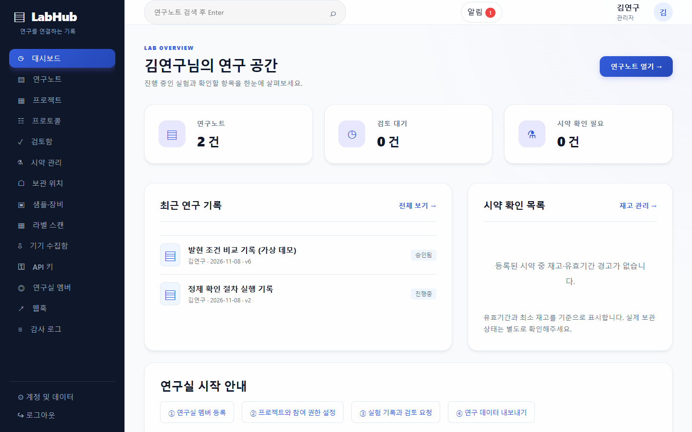
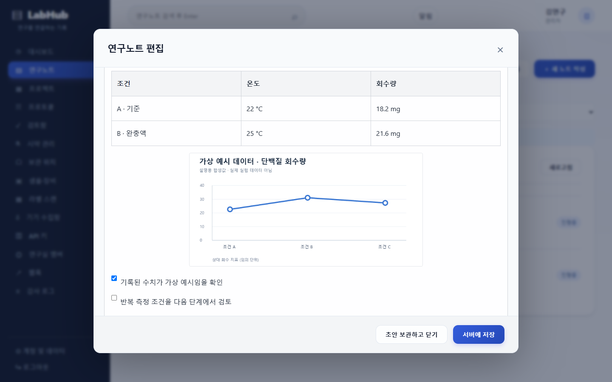
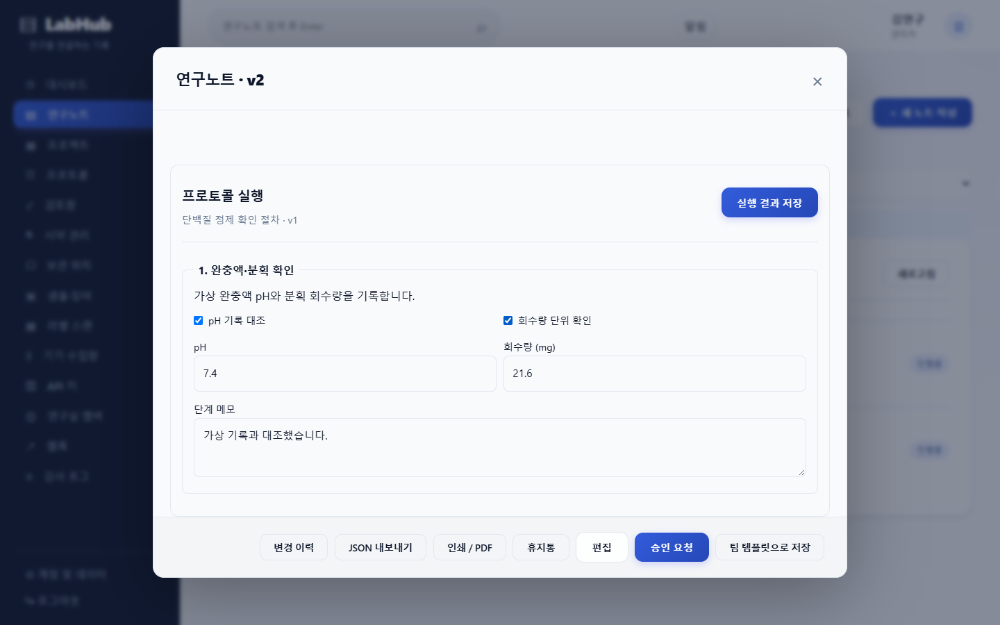
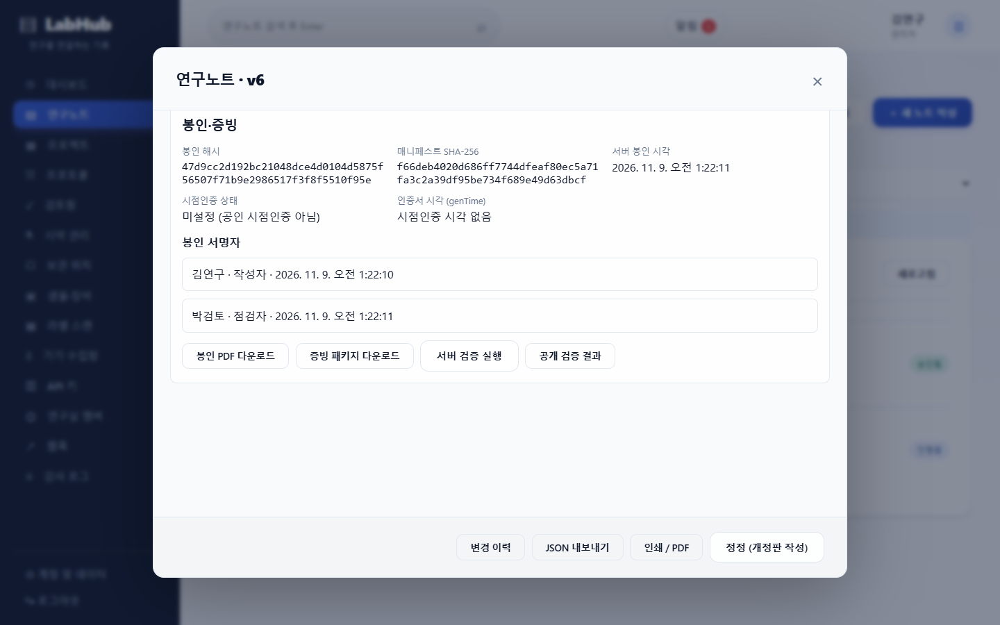
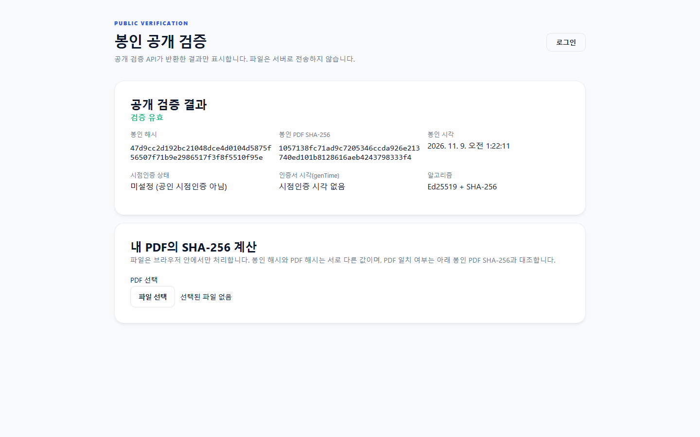
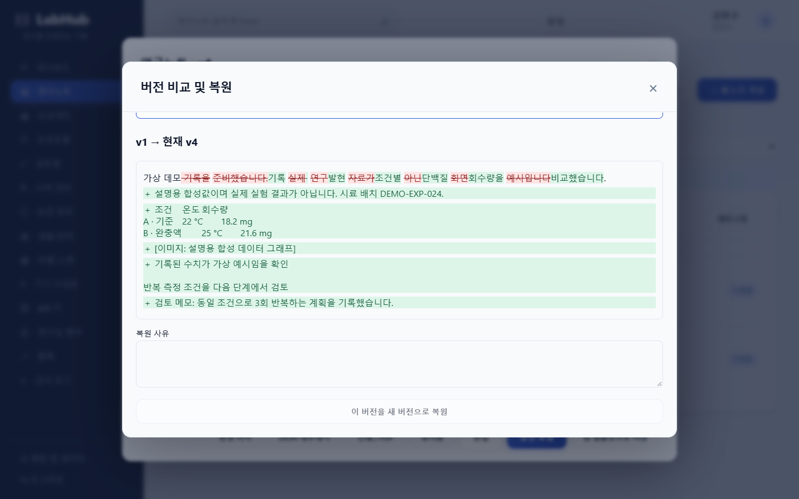
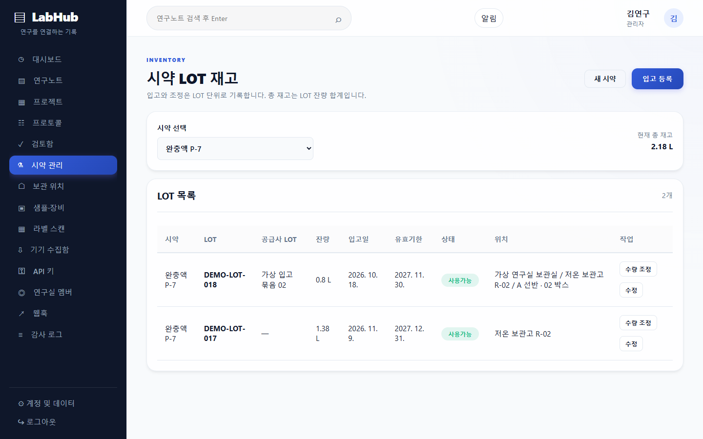
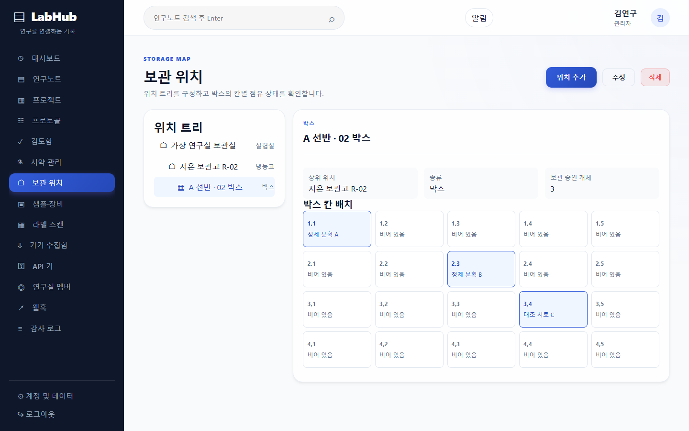
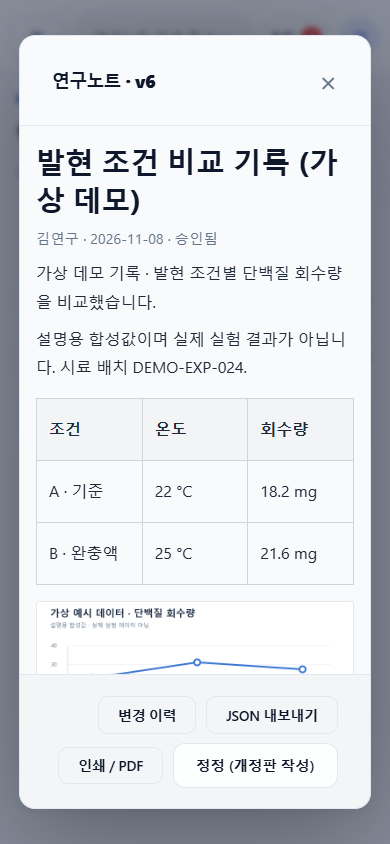

<div align="center">

# LabHub

**실험 기록, 시약 재고, 서명과 증빙을 하나로 잇는 연구노트**

React 19 · Express 5 · MongoDB · Node.js 24

</div>



LabHub는 연구실의 하루를 한곳에 모읍니다. 블록 편집기로 실험을 기록하고, 사용한 시약을 LOT 단위로 재고와 연결하며, 작성자와 점검자의 서명을 거친 기록을 위변조 여부를 확인할 수 있는 증빙으로 봉인합니다.

## 주요 기능

### 기록
표, 이미지, 체크리스트, 수식을 쓰는 블록 편집기와 프로젝트 → 실험 → 노트 구조를 제공합니다. 버전 있는 프로토콜을 단계별로 실행해 결과를 남기고, 어떤 버전이든 비교하고 복원할 수 있습니다.

<table>
  <tr>
    <td width="50%"><br><sub>블록 편집기</sub></td>
    <td width="50%"><br><sub>프로토콜 단계별 실행</sub></td>
  </tr>
</table>

### 서명과 증빙
작성자와 점검자가 각자의 Ed25519 키로 서명하면 기록이 봉인되고, 장기 보존용 PDF와 오프라인 검증 스크립트가 든 증빙 패키지가 만들어집니다. 승인된 기록은 수정할 수 없고 개정판으로만 정정합니다. 감사 로그는 해시 체인으로 변조를 탐지합니다.

<table>
  <tr>
    <td width="50%"><br><sub>봉인과 증빙</sub></td>
    <td width="50%"><br><sub>로그인 없는 공개 검증</sub></td>
  </tr>
  <tr>
    <td width="50%"><br><sub>버전 비교와 복원</sub></td>
    <td width="50%"></td>
  </tr>
</table>

### 재고와 장비
시약 사용량은 노트 저장과 같은 트랜잭션으로 LOT에서 차감됩니다. 유효기간이 가까운 LOT부터 배정하고, 보관 위치와 박스 칸, 샘플, 장비 예약과 교정 일정, QR 라벨 출력과 스캔까지 관리합니다.

<table>
  <tr>
    <td width="50%"><br><sub>LOT 재고</sub></td>
    <td width="50%"><br><sub>보관함 칸 배치</sub></td>
  </tr>
</table>

### 협업과 연동
- 댓글, 멘션, 알림, 승인함과 한국어 부분 일치를 지원하는 서버 검색
- 프로젝트별 보기·편집·관리 권한, MFA(TOTP), OIDC 로그인, 메일 초대와 비밀번호 재설정
- 범위를 제한하는 API 키와 공개 REST API, 서명된 웹훅
- 장비 PC의 결과 파일을 원본 변경 없이 올리는 폴더 업로더 ([`tools/instrument-agent`](tools/instrument-agent))
- 로컬 디스크 또는 S3 호환 저장소

<p align="center"></p>

## 빠른 시작

Node.js 24 이상이 필요합니다.

```sh
npm run setup
npm run build
npm start
```

<http://127.0.0.1:5000> 에 접속해 최초 관리자 계정을 만듭니다. 처음 실행할 때 로컬 MongoDB 실행 파일을 내려받으므로 인터넷 연결이 필요하며, 데이터는 `backend/data`에 저장됩니다. 이 방식은 개인 사용과 개발용입니다.

개발 중에는 별도 터미널에서 `npm --prefix frontend run dev`를 실행하면 5173번 포트의 화면이 API에 연결됩니다.

### Docker로 운영하기

MongoDB replica set, 앱, HTTPS 프록시(Caddy)를 함께 실행합니다.

```sh
cp deploy/.env.example deploy/.env
# deploy/.env 의 도메인과 비밀 값을 채웁니다
docker compose -f deploy/docker-compose.yml up -d --build
```

자세한 절차는 [설치 안내](docs/guides/install.md)를 참고하세요.

## 선택 기능

아래 기능은 기본적으로 꺼져 있으며, 켜지 않아도 앱은 그대로 동작합니다.

| 기능 | 설정 | 알아 둘 점 |
|---|---|---|
| 시점인증 | `TIMESTAMP_PROVIDER` | RFC 3161 TSA를 연결할 수 있습니다. 설정하지 않으면 기록 시각은 서버 시계에만 의존합니다. [안내](docs/guides/timestamp.md) |
| AI 보조 | `AI_PROVIDER` | 초안 작성, 프로토콜 생성, 표 추출, 누락 점검, 출처 표시 질의. 켜면 해당 연구 내용이 AI 제공자에게 전송됩니다. |
| 메일 | `MAIL_PROVIDER` | 초대와 비밀번호 재설정에 사용합니다. |
| 대용량 검색 | `SEARCH_PROVIDER` | 기본 메모리 색인은 단일 서버용이며, 규모가 커지면 Meilisearch로 전환합니다. |

## 구조

```text
backend/    Express API, 서명·봉인, 감사 로그, 백그라운드 작업
frontend/   React 화면
packages/   문서 형식, 편집기, 검색, 라벨, AI 공용 패키지
tools/      장비 폴더 업로더, 부하 테스트
deploy/     Dockerfile, Compose, 백업·복구 스크립트
docs/       운영 안내와 화면 이미지
```

## 운영 문서

- [설치와 업그레이드](docs/guides/install.md)
- [시점인증 설정](docs/guides/timestamp.md)
- [백업과 복원](docs/guides/backup-restore.md)
- [운영 전 보안 점검표](docs/guides/security-checklist.md)
- [연구노트 지침 대응표](docs/guides/regulatory-mapping.md)
- [부하 테스트](docs/guides/loadtest.md)

## 테스트

```sh
npm test
npm run test:e2e
```

테스트는 임시 DB를 사용하며 실제 데이터를 변경하지 않습니다. 브라우저 테스트는 Windows Edge를 기본으로 사용하고 `PLAYWRIGHT_CHANNEL`로 바꿀 수 있으며, 5000번과 5173번 포트가 비어 있어야 합니다.

## 알아 두세요

LabHub는 규정 준수 인증, 공인 전자서명, 공인 시점인증을 제공한다고 주장하지 않습니다. 앱의 서명은 내부 전자서명이며, 법적 효력과 기관 규정 충족 여부는 도입 기관이 직접 확인해야 합니다.
